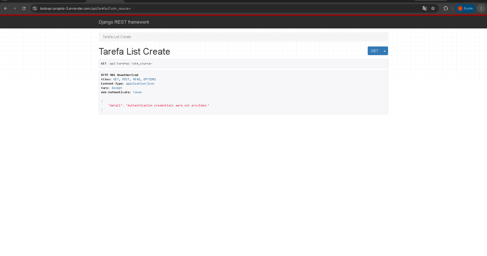
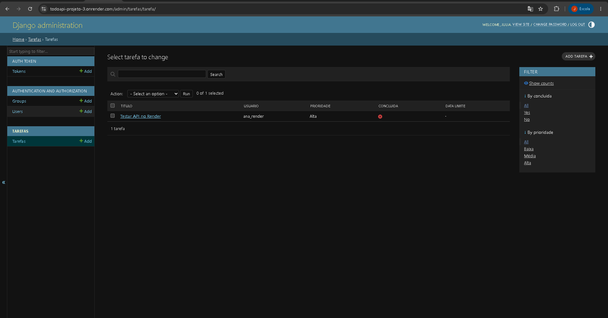

# Projeto 3 — API de Tarefas

**Curso:** Análise e Desenvolvimento de Sistemas — IESB  
**Disciplina:** Construção de Backend  
**Tecnologias:** Python, Django, Django REST Framework e SQLite

## 1. Descrição

API REST para gerenciamento de tarefas, com autenticação por Token e isolamento de dados por usuário.

Cada usuário autenticado pode criar, listar, consultar, atualizar e excluir suas próprias tarefas.

## 2. Funcionalidades

- Autenticação por Token.
- Criação, listagem, atualização e exclusão de tarefas.
- Filtros por prioridade e situação de conclusão.
- Proteção contra acesso a tarefas de outros usuários.
- Ordenação por data limite.
- Paginação opcional.
- Criação de subtarefas.
- Estatísticas de tarefas concluídas e pendentes.

## 3. Estrutura do projeto

- `todoapi/`: configurações e URLs principais.
- `tarefas/models.py`: modelo de dados.
- `tarefas/serializers.py`: serialização e validações.
- `tarefas/views.py`: regras de negócio e endpoints.
- `tarefas/urls.py`: rotas das tarefas.
- `tarefas/pagination.py`: paginação opcional.
- `tarefas/admin.py`: configuração do Django Admin.
- `tarefas/tests.py`: oito testes obrigatórios.
- `tarefas/test_extras.py`: seis testes adicionais.

## 4. Como executar localmente

Crie e ative o ambiente virtual no Windows:

```cmd
python -m venv venv
venv\Scripts\activate
```

Instale as dependências:

```cmd
pip install -r requirements.txt
```

Crie um arquivo `.env` na raiz do projeto com a variável `DJANGO_SECRET_KEY`, contendo uma chave secreta gerada para sua instalação.

Depois, execute:

```cmd
python manage.py migrate
python manage.py createsuperuser
python manage.py runserver
```

A API estará disponível em `http://127.0.0.1:8000/`.

## 5. Endpoints

| Método | Rota | Finalidade |
|---|---|---|
| POST | `/api/login/` | Obter token |
| GET | `/api/tarefas/` | Listar tarefas próprias |
| POST | `/api/tarefas/` | Criar tarefa |
| GET | `/api/tarefas/<id>/` | Consultar tarefa |
| PUT | `/api/tarefas/<id>/` | Atualizar tarefa |
| PATCH | `/api/tarefas/<id>/` | Atualizar parcialmente |
| DELETE | `/api/tarefas/<id>/` | Excluir tarefa |
| GET | `/api/tarefas/estatisticas/` | Consultar estatísticas |

## 6. Exemplos de utilização

### Login

Requisição:

```http
POST /api/login/
Content-Type: application/json
```

```json
{
  "username": "usuario_exemplo",
  "password": "senha_de_exemplo"
}
```

Resposta ilustrativa:

```json
{
  "token": "TOKEN_EXEMPLO"
}
```

As requisições protegidas utilizam o cabeçalho:

```http
Authorization: Token SEU_TOKEN
```

### Criar tarefa

```http
POST /api/tarefas/
Authorization: Token SEU_TOKEN
Content-Type: application/json
```

```json
{
  "titulo": "Estudar Django",
  "descricao": "Revisar autenticação e API REST",
  "prioridade": "ALTA",
  "concluida": false,
  "data_limite": "2026-11-10"
}
```

O proprietário da tarefa é definido automaticamente pelo token autenticado.

### Filtros

```http
GET /api/tarefas/?prioridade=alta
GET /api/tarefas/?concluida=false
GET /api/tarefas/?concluida=true&prioridade=alta
```

### Ordenação

```http
GET /api/tarefas/?ordering=data_limite
GET /api/tarefas/?ordering=-data_limite
```

### Paginação opcional

```http
GET /api/tarefas/?page=1
GET /api/tarefas/?page=2
GET /api/tarefas/?page=1&page_size=10
```

### Subtarefas

Uma subtarefa pode ser criada informando o ID de outra tarefa do mesmo usuário:

```json
{
  "titulo": "Revisar serializers",
  "tarefa_pai": 1
}
```

A API impede que uma tarefa seja vinculada a uma tarefa de outro usuário.

### Estatísticas

```http
GET /api/tarefas/estatisticas/
```

Exemplo ilustrativo de resposta:

```json
{
  "total": 10,
  "concluidas": 6,
  "pendentes": 4
}
```

## 7. Segurança

O projeto utiliza `TokenAuthentication` e `IsAuthenticated`.

O acesso à listagem sem token retorna HTTP 401.

Uma tentativa de acessar uma tarefa pertencente a outro usuário retorna HTTP 404.

A chave secreta é carregada da variável de ambiente `DJANGO_SECRET_KEY`. O arquivo `.env` é ignorado pelo Git e não deve ser publicado.

## 8. Testes automatizados

Execute:

```cmd
python manage.py test
```

**Resultado obtido durante o desenvolvimento:**

- 8 testes obrigatórios aprovados.
- 6 testes adicionais aprovados.
- Total: 14 testes.
- Nenhuma falha.

Os testes adicionais verificam paginação, ordenação, criação de subtarefas, proteção entre usuários e estatísticas.

## 9. Dificuldades e aprendizados

Durante o desenvolvimento foi necessário compreender a divisão de responsabilidades entre as URLs principais do projeto e as URLs do aplicativo.

A resposta HTTP 401 visualizada ao acessar a API sem token demonstrou a aplicação da autenticação obrigatória.

Outro aprendizado importante foi a diferença entre autenticação e autorização: possuir um token válido não permite acessar as tarefas de outro usuário.

A implementação da paginação exigiu atenção especial, pois os testes originais esperavam respostas em formato de lista. Para preservar a compatibilidade, a paginação foi configurada para funcionar quando solicitada por parâmetros de consulta.

A implementação das subtarefas também exigiu validações adicionais para impedir vínculos indevidos entre usuários e referências circulares.

## 10. Evidências

As evidências do projeto incluem:

- Resultado dos testes automatizados.
- Configuração do Django Admin.
- Resposta HTTP 401 sem autenticação.
- Exemplos de requisições autenticadas.
- Consultas com filtros e estatísticas.

As capturas de tela poderão ser adicionadas à pasta `prints/`.

## 11. Publicação

O código-fonte está disponível em:

https://github.com/juliarmst-creator/todoapi-projeto-3

## 12. Deploy no Render

A API foi publicada no Render, utilizando Django, Gunicorn,
WhiteNoise e PostgreSQL.

**URL pública:** https://todoapi-projeto-3.onrender.com

**Endpoint de tarefas:**
https://todoapi-projeto-3.onrender.com/api/tarefas/

O acesso sem Token retorna HTTP 401 Unauthorized,
confirmando a exigência de autenticação na API publicada.

### Evidência do deploy



## 13. Testes reais no ambiente de produção

Após o deploy, foram realizados testes diretamente na API
publicada no Render, utilizando o banco PostgreSQL.

### Autenticação

O endpoint `POST /api/login/` foi testado com um usuário
cadastrado no PostgreSQL.

**Resultado:** HTTP 200 OK, com geração de Token.

### Criação de tarefa

Uma tarefa foi criada por meio de uma requisição autenticada
à rota `POST /api/tarefas/`.

- Título: Testar API no Render
- Usuário: ana_render
- Prioridade: Alta
- Concluída: Não

**Resultado:** HTTP 201 Created.

A tarefa também foi localizada no Django Admin publicado,
confirmando sua persistência no PostgreSQL.



### Estatísticas

Foi realizada uma requisição autenticada:

`GET /api/tarefas/estatisticas/`

**Resultado real:** HTTP 200 OK.

```json
{
  "total": 1,
  "concluidas": 0,
  "pendentes": 1
}
```

O resultado corresponde à tarefa criada no ambiente publicado.

### Conclusão

A API foi implementada e publicada com sucesso, incluindo
as funcionalidades obrigatórias, os quatro desafios adicionais
de código e o deploy.

Os 14 testes automatizados foram aprovados, sem falhas.

**API publicada:** https://todoapi-projeto-3.onrender.com/api/tarefas/
